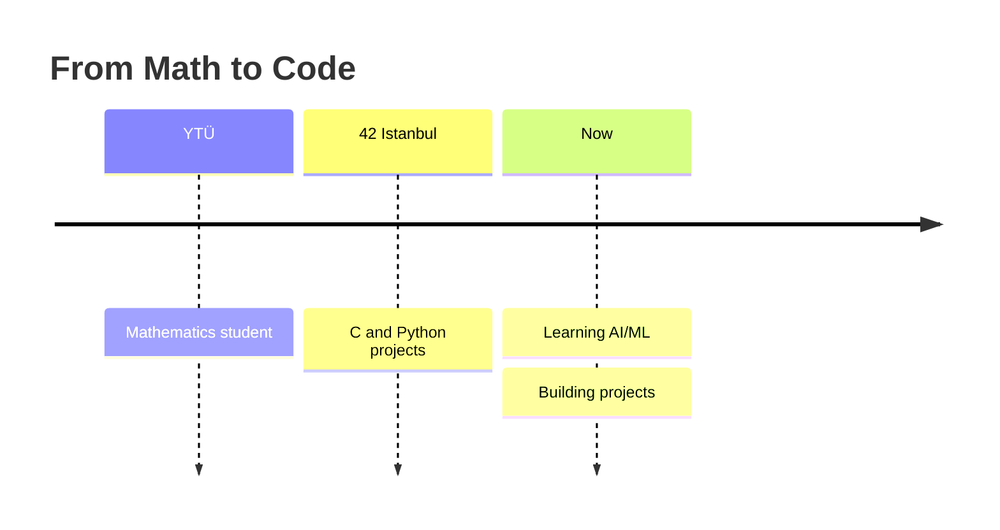
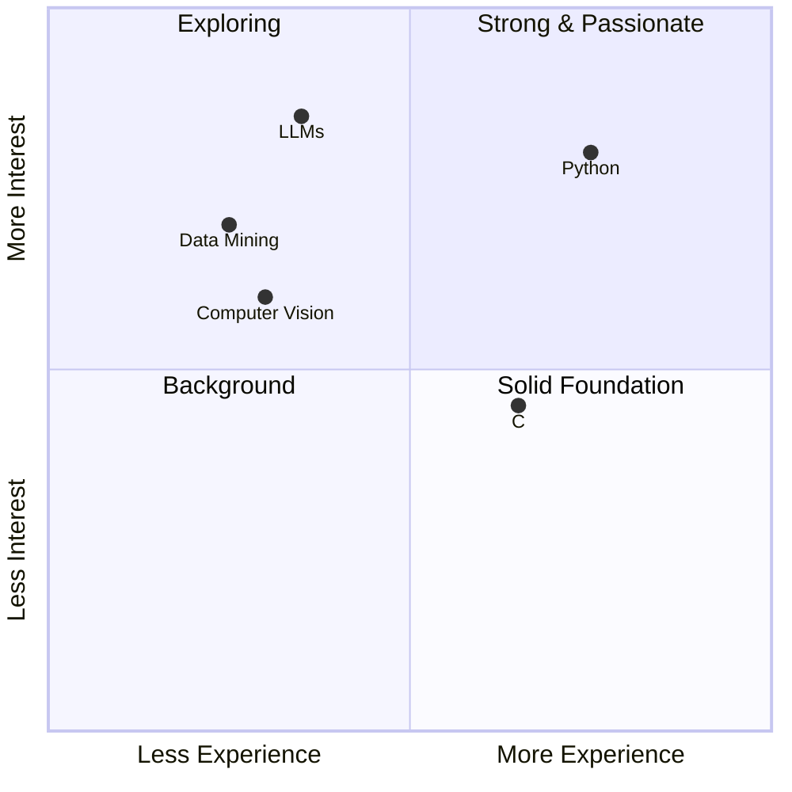

<!-- Banner -->
<p align="center">
  
</p>

<!-- Typing effect -->
<p align="center">
  <a href="https://github.com/edpolat">
    
  </a>
</p>

---

## 👩‍💻 About Me

```bash
$ whoami
```

- 🎓 4th-year **Mathematics** student at **Yıldız Technical University**
- 🚀 Student at **42 Istanbul**
- 🤖 Currently exploring **AI/ML**, **LLMs** and **data mining**
- 🌍 Based in **Istanbul**

My life, in one equation:

$$\lim_{\text{coffee} \to \infty} \text{bugs} = 0$$

---

## 🧭 My Journey



---

## 🛠️ Tech Stack

<p>
  
  
  
  
  
  
  
  
</p>

---

## 🌟 Featured Projects

| Project | Description | Tech |
|---|---|---|
| 🔐 **KVKK LLM Guard** | Masks personal data in text before it is sent to LLMs | Python |
| 📞 **call me maybe** | Function calling in LLMs with constrained decoding | Python, Pydantic |
| 👁️ **Detection Lab** | Face & object detection with Haar Cascade and MobileNet-SSD | Python, OpenCV |


---

## 🗺️ Skills Map



---

## 📫 Let's Connect

<p>
  <a href="https://www.linkedin.com/in/eda-nur-polat-1459272ba/"></a>
  <a href="mailto:edanurpolat03@gmail.com"></a>
</p>

<!-- Footer -->
<p align="center">
  
</p>
